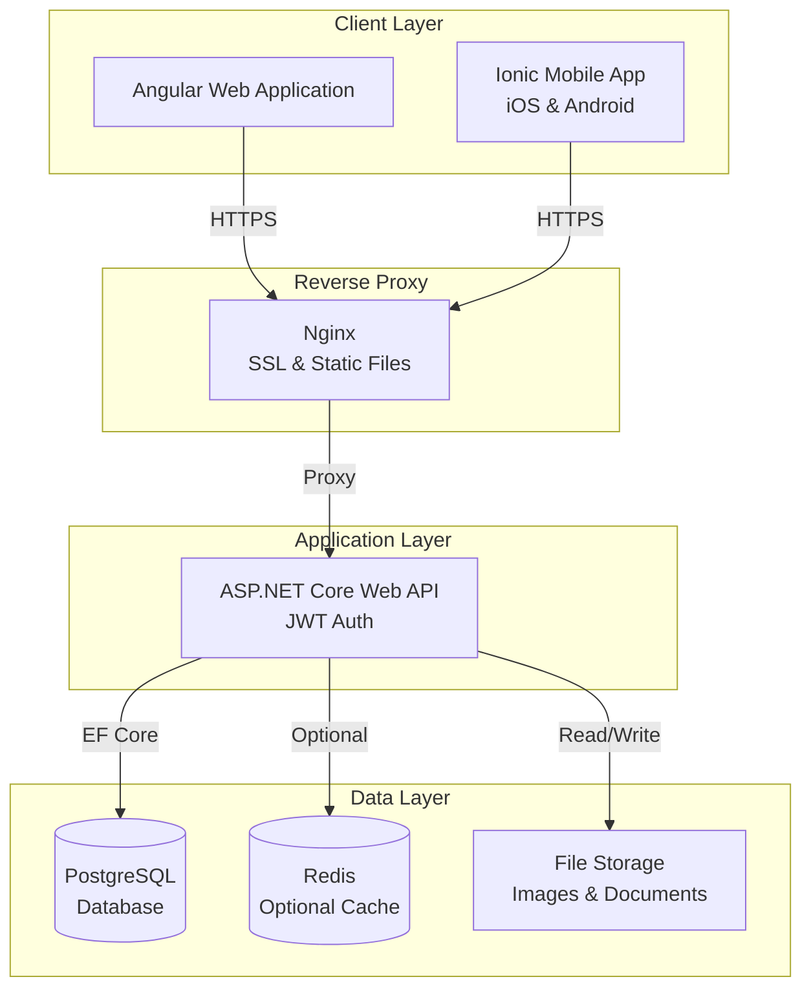
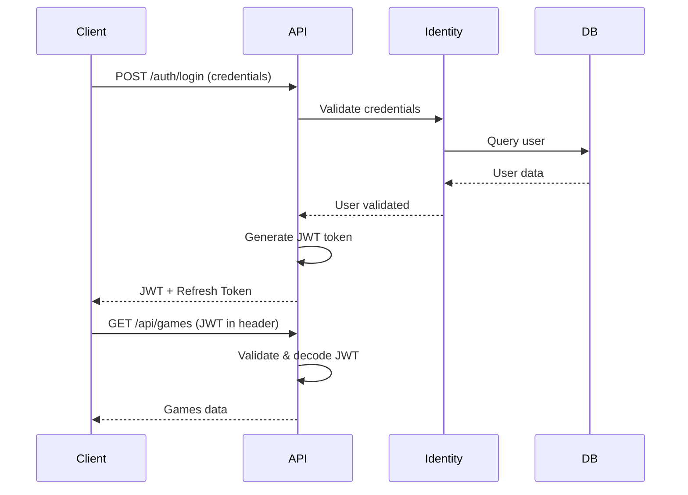
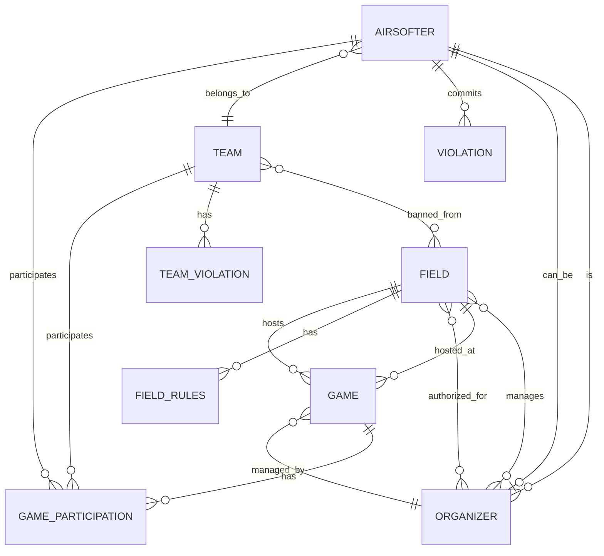
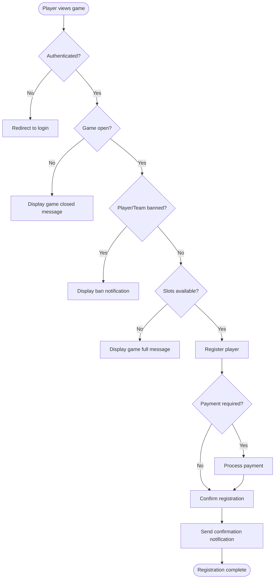
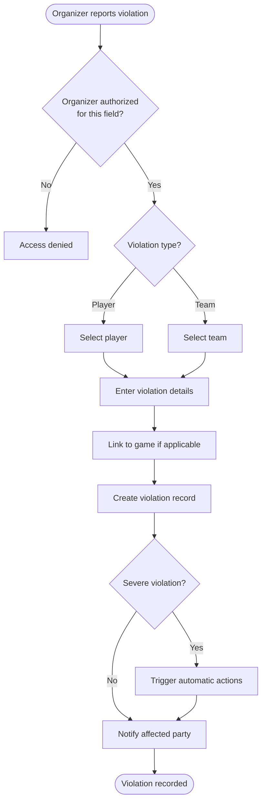
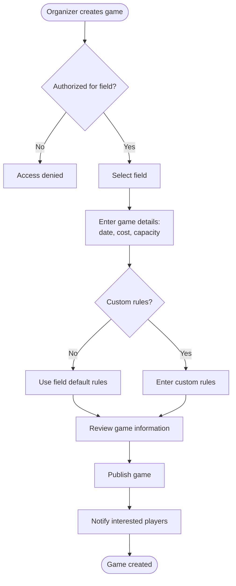
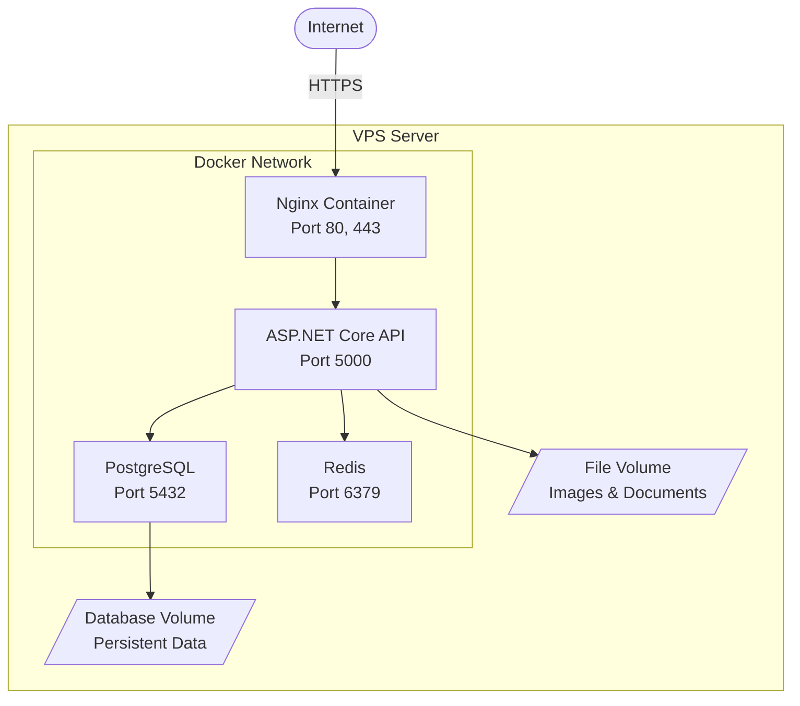

# Strikeball Social Network - Design Document

## Project Overview

A web-based social network platform for airsoft (strikeball) enthusiasts that enables community members to connect, organize games, track their history, and manage team activities. The platform serves as a centralized hub for players, teams, game organizers, and field operators.

## Core Entities

### 1. Airsofter (Player)

Represents an individual participant in the airsoft community.

**Attributes:**

| Field | Type | Required | Description |
|-------|------|----------|-------------|
| Last Name | Text | Yes | Player's family name |
| First Name | Text | Yes | Player's given name |
| Middle Name | Text | No | Patronymic or middle name |
| Callsign | Text | Yes | Unique identifier used during games |
| Kit Description | Text | No | Description of player's equipment and loadout |
| Airsoft Guns List | Text | No | List of airsoft replicas owned by the player |
| Game History | Reference List | Auto | Collection of games the player participated in |
| Team Affiliation | Reference | No | Link to the team the player belongs to |
| Violations List | Collection | Auto | Records of rule violations with dates |

### 2. Team

Represents an organized group of airsofters.

**Attributes:**

| Field | Type | Required | Description |
|-------|------|----------|-------------|
| Full Name | Text | Yes | Complete team name |
| Abbreviation | Text | No | Short form of team name |
| Logo | Image | No | Team's visual identity |
| Game History | Reference List | Auto | Games participated in by the team |
| Team Violations | Collection | Auto | Rule violations committed by the team as entity |
| Members List | Reference List | Yes | Links to airsofter profiles who are team members |
| Member Violations | Collection | Auto | Aggregated violations of all team members |
| Fields List | Reference List | Auto | Fields where the team has played |

### 3. Game

Represents a scheduled or completed airsoft event.

**Attributes:**

| Field | Type | Required | Description |
|-------|------|----------|-------------|
| Date | DateTime | Yes | When the game takes place |
| Field | Reference | Yes | Link to the field where game is held |
| Rules | Reference/Text | Yes | Either reference to field rules or custom rules |
| Participants List | Reference List | Yes | Links to airsofters registered for the game |
| Cost | Decimal | Yes | Participation fee |
| Organizer | Reference | Yes | Link to the organizer managing this game |
| Status | Enum | Yes | Scheduled, In Progress, Completed, Cancelled |

### 4. Field (Polygon)

Represents a physical location where airsoft games are held.

**Attributes:**

| Field | Type | Required | Description |
|-------|------|----------|-------------|
| Name | Text | Yes | Field name |
| Map | Image/File | No | Visual representation of the field layout |
| Coordinates | Geographic | Yes | GPS location (latitude, longitude) |
| Game History | Reference List | Auto | Games that took place at this field |
| Field Rules | Text/Document | Yes | Official rules enforced at this field |
| Banned Teams | Reference List | No | Teams prohibited from playing at this field |
| Address | Text | Yes | Human-readable location |

### 5. Organizer

Represents a user with elevated permissions to manage games and events at specific fields.

**Attributes:**

| Field | Type | Required | Description |
|-------|------|----------|-------------|
| User Reference | Reference | Yes | Link to airsofter profile |
| Authorized Fields | Reference List | Yes | Fields where organizer has management rights |
| Permissions | Collection | Yes | Specific rights (publish games, moderate, manage violations) |

## Technology Stack

### Frontend Architecture

**Web Application:**
- **Framework**: Angular (latest LTS version)
- **Language**: TypeScript
- **UI Component Library**: Angular Material or PrimeNG
- **State Management**: NgRx or Akita
- **HTTP Client**: Angular HttpClient
- **Maps Integration**: Leaflet with OpenStreetMap

**Mobile Applications:**
- **Framework**: Ionic Framework with Angular
- **Target Platforms**: iOS and Android
- **Code Sharing**: Maximum reuse of Angular components and services between web and mobile

### Backend Architecture

**API Layer:**
- **Framework**: ASP.NET Core Web API (latest LTS version)
- **Language**: C#
- **Architecture Pattern**: Clean Architecture with CQRS
- **Authentication**: ASP.NET Core Identity with JWT
- **Authorization**: Role-based and policy-based authorization
- **API Documentation**: Swagger/OpenAPI

**Data Access:**
- **ORM**: Entity Framework Core
- **Database Migrations**: EF Core Migrations
- **Repository Pattern**: Generic repository with unit of work

### Database

**Primary Database:**
- **Engine**: PostgreSQL (open-source, robust, excellent for complex queries)
- **Reasoning**: Free, excellent performance, supports geographic data types for coordinates, strong JSON support for flexible fields

**Alternative Option:**
- **Engine**: MySQL/MariaDB (if team has more experience)

### File Storage

**Storage Solution:**
- **Primary**: Local file system with organized directory structure
- **Images**: Team logos, field maps, kit photos
- **Organization**: Categorized folders with metadata stored in database
- **Future Scaling**: MinIO (S3-compatible object storage) for when local storage becomes insufficient

### Caching Layer

**Cache Implementation:**
- **Engine**: Redis (optional for initial phase)
- **Usage**: Session storage, frequently accessed data, API response caching
- **Reasoning**: Open-source, high performance, reduces database load for large communities

### Infrastructure Components

**Web Server:**
- **Engine**: Kestrel (built into ASP.NET Core)
- **Reverse Proxy**: Nginx
- **Purpose**: SSL termination, static file serving, load balancing preparation

**Containerization:**
- **Platform**: Docker
- **Orchestration**: Docker Compose for single VPS deployment
- **Components**: Separate containers for API, database, cache, reverse proxy

**Version Control:**
- **Platform**: Git
- **Repository Hosting**: GitHub, GitLab, or Gitea (self-hosted)

## System Architecture

## Authentication & Authorization Model

### User Roles

| Role | Description | Permissions |
|------|-------------|-------------|
| Guest | Unauthenticated visitor | View public games, fields, teams |
| Airsofter | Registered player | Full guest permissions + manage own profile, register for games |
| Team Leader | Team administrator | Full airsofter permissions + manage team profile, team roster |
| Organizer | Event manager | Full airsofter permissions + create/manage games at authorized fields, record violations |
| Field Owner | Field administrator | Full organizer permissions + manage field settings, assign organizers, ban teams |
| Administrator | Platform admin | All permissions across the system |

### Authentication Flow

## Data Relationships

## Key Workflows

### Player Registration for Game

### Violation Recording

### Game Creation by Organizer

## API Structure

### Core API Endpoints

**Authentication:**
- POST /api/auth/register
- POST /api/auth/login
- POST /api/auth/refresh-token
- POST /api/auth/logout

**Airsofters:**
- GET /api/airsofters
- GET /api/airsofters/{id}
- POST /api/airsofters
- PUT /api/airsofters/{id}
- DELETE /api/airsofters/{id}
- GET /api/airsofters/{id}/game-history
- GET /api/airsofters/{id}/violations

**Teams:**
- GET /api/teams
- GET /api/teams/{id}
- POST /api/teams
- PUT /api/teams/{id}
- DELETE /api/teams/{id}
- POST /api/teams/{id}/members
- DELETE /api/teams/{id}/members/{memberId}
- GET /api/teams/{id}/game-history

**Games:**
- GET /api/games
- GET /api/games/{id}
- POST /api/games
- PUT /api/games/{id}
- DELETE /api/games/{id}
- POST /api/games/{id}/register
- DELETE /api/games/{id}/unregister
- GET /api/games/{id}/participants

**Fields:**
- GET /api/fields
- GET /api/fields/{id}
- POST /api/fields
- PUT /api/fields/{id}
- DELETE /api/fields/{id}
- GET /api/fields/{id}/games
- POST /api/fields/{id}/ban-team
- DELETE /api/fields/{id}/unban-team/{teamId}

**Violations:**
- GET /api/violations
- GET /api/violations/{id}
- POST /api/violations
- PUT /api/violations/{id}
- DELETE /api/violations/{id}

**Organizers:**
- GET /api/organizers
- GET /api/organizers/{id}
- POST /api/organizers
- PUT /api/organizers/{id}
- DELETE /api/organizers/{id}
- POST /api/organizers/{id}/authorize-field
- DELETE /api/organizers/{id}/revoke-field/{fieldId}

## Database Schema Considerations

### Airsofters Table

| Column | Type | Constraints |
|--------|------|-------------|
| Id | UUID/GUID | Primary Key |
| FirstName | VARCHAR(100) | NOT NULL |
| LastName | VARCHAR(100) | NOT NULL |
| MiddleName | VARCHAR(100) | NULL |
| Callsign | VARCHAR(50) | NOT NULL, UNIQUE |
| KitDescription | TEXT | NULL |
| AirsoftGunsList | TEXT | NULL |
| TeamId | UUID/GUID | Foreign Key, NULL |
| UserId | UUID/GUID | Foreign Key, NOT NULL |
| CreatedAt | TIMESTAMP | NOT NULL |
| UpdatedAt | TIMESTAMP | NOT NULL |

### Teams Table

| Column | Type | Constraints |
|--------|------|-------------|
| Id | UUID/GUID | Primary Key |
| FullName | VARCHAR(200) | NOT NULL |
| Abbreviation | VARCHAR(20) | NULL |
| LogoUrl | VARCHAR(500) | NULL |
| CreatedAt | TIMESTAMP | NOT NULL |
| UpdatedAt | TIMESTAMP | NOT NULL |

### Games Table

| Column | Type | Constraints |
|--------|------|-------------|
| Id | UUID/GUID | Primary Key |
| Date | TIMESTAMP | NOT NULL |
| FieldId | UUID/GUID | Foreign Key, NOT NULL |
| Cost | DECIMAL(10,2) | NOT NULL |
| Status | VARCHAR(20) | NOT NULL |
| OrganizerId | UUID/GUID | Foreign Key, NOT NULL |
| CustomRules | TEXT | NULL |
| UseFieldRules | BOOLEAN | NOT NULL |
| MaxParticipants | INTEGER | NULL |
| CreatedAt | TIMESTAMP | NOT NULL |
| UpdatedAt | TIMESTAMP | NOT NULL |

### Fields Table

| Column | Type | Constraints |
|--------|------|-------------|
| Id | UUID/GUID | Primary Key |
| Name | VARCHAR(200) | NOT NULL |
| Address | VARCHAR(500) | NOT NULL |
| Latitude | DECIMAL(10,8) | NOT NULL |
| Longitude | DECIMAL(11,8) | NOT NULL |
| MapUrl | VARCHAR(500) | NULL |
| Rules | TEXT | NOT NULL |
| CreatedAt | TIMESTAMP | NOT NULL |
| UpdatedAt | TIMESTAMP | NOT NULL |

### Violations Table

| Column | Type | Constraints |
|--------|------|-------------|
| Id | UUID/GUID | Primary Key |
| AirsofterId | UUID/GUID | Foreign Key, NULL |
| TeamId | UUID/GUID | Foreign Key, NULL |
| FieldId | UUID/GUID | Foreign Key, NOT NULL |
| GameId | UUID/GUID | Foreign Key, NULL |
| Description | TEXT | NOT NULL |
| Date | TIMESTAMP | NOT NULL |
| Severity | VARCHAR(20) | NOT NULL |
| RecordedById | UUID/GUID | Foreign Key, NOT NULL |
| CreatedAt | TIMESTAMP | NOT NULL |

### Game Participants Table

| Column | Type | Constraints |
|--------|------|-------------|
| Id | UUID/GUID | Primary Key |
| GameId | UUID/GUID | Foreign Key, NOT NULL |
| AirsofterId | UUID/GUID | Foreign Key, NOT NULL |
| TeamId | UUID/GUID | Foreign Key, NULL |
| RegisteredAt | TIMESTAMP | NOT NULL |
| Status | VARCHAR(20) | NOT NULL |

### Organizers Table

| Column | Type | Constraints |
|--------|------|-------------|
| Id | UUID/GUID | Primary Key |
| AirsofterId | UUID/GUID | Foreign Key, NOT NULL |
| CreatedAt | TIMESTAMP | NOT NULL |
| UpdatedAt | TIMESTAMP | NOT NULL |

### Organizer Field Authorizations Table

| Column | Type | Constraints |
|--------|------|-------------|
| Id | UUID/GUID | Primary Key |
| OrganizerId | UUID/GUID | Foreign Key, NOT NULL |
| FieldId | UUID/GUID | Foreign Key, NOT NULL |
| CanPublishGames | BOOLEAN | NOT NULL |
| CanModerateGames | BOOLEAN | NOT NULL |
| CanRecordViolations | BOOLEAN | NOT NULL |
| GrantedAt | TIMESTAMP | NOT NULL |

### Field Banned Teams Table

| Column | Type | Constraints |
|--------|------|-------------|
| Id | UUID/GUID | Primary Key |
| FieldId | UUID/GUID | Foreign Key, NOT NULL |
| TeamId | UUID/GUID | Foreign Key, NOT NULL |
| Reason | TEXT | NOT NULL |
| BannedAt | TIMESTAMP | NOT NULL |
| BannedUntil | TIMESTAMP | NULL |

## Deployment Architecture

### VPS Environment Setup

**Container Organization:**

### Docker Compose Configuration

**Services Overview:**

1. **Nginx Service**: Handles SSL certificates, serves static files, reverse proxy to API
2. **API Service**: ASP.NET Core application
3. **PostgreSQL Service**: Database with persistent volume
4. **Redis Service**: Optional caching layer with persistent volume
5. **Backup Service**: Scheduled database backups

**Docker Compose Structure:**

The deployment uses Docker Compose to orchestrate all services. The composition includes the following services:

| Service | Image | Purpose | Ports | Dependencies |
|---------|-------|---------|-------|-------------|
| nginx | nginx:alpine | Reverse proxy and SSL termination | 80, 443 | api |
| api | Custom .NET image | Backend API service | 5000 (internal) | postgres, redis |
| postgres | postgres:15-alpine | Primary database | 5432 (internal) | None |
| redis | redis:7-alpine | Caching layer | 6379 (internal) | None |
| backup | Custom backup image | Automated database backups | None | postgres |

**Network Configuration:**

- All services communicate through a custom bridge network named `strikeball-network`
- Only Nginx exposes ports to the host machine
- Internal services communicate using service names as hostnames

**Volume Configuration:**

| Volume Name | Purpose | Mounted To |
|-------------|---------|------------|
| postgres-data | PostgreSQL database files | postgres:/var/lib/postgresql/data |
| redis-data | Redis persistence | redis:/data |
| api-files | Uploaded images and documents | api:/app/files |
| nginx-conf | Nginx configuration | nginx:/etc/nginx/conf.d |
| nginx-certs | SSL certificates | nginx:/etc/nginx/certs |
| backup-data | Database backup files | backup:/backups |

**Environment Variables Structure:**

Each service requires specific environment variables:

**API Service:**
- Database connection string
- Redis connection string
- JWT secret key
- CORS allowed origins
- File storage path
- Logging level

**PostgreSQL Service:**
- Database name
- Database user
- Database password
- Locale settings

**Redis Service:**
- Password
- Max memory policy
- Persistence configuration

**Nginx Service:**
- Server name (domain)
- SSL certificate paths
- API upstream URL

**Health Checks:**

Each service includes health check configuration:

| Service | Health Check Endpoint | Interval | Timeout | Retries |
|---------|----------------------|----------|---------|----------|
| api | GET /health | 30s | 10s | 3 |
| postgres | pg_isready | 10s | 5s | 5 |
| redis | redis-cli ping | 10s | 5s | 5 |
| nginx | curl localhost:80/health | 30s | 10s | 3 |

**Restart Policies:**

- All services use `unless-stopped` restart policy
- Ensures services automatically restart after failure or system reboot
- Manual stops are respected

**Resource Limits:**

Recommended resource allocation for medium-scale deployment:

| Service | CPU Limit | Memory Limit | Memory Reservation |
|---------|-----------|--------------|--------------------|
| api | 2.0 | 2GB | 1GB |
| postgres | 2.0 | 4GB | 2GB |
| redis | 1.0 | 1GB | 512MB |
| nginx | 0.5 | 512MB | 256MB |
| backup | 0.5 | 512MB | 256MB |

**Deployment Steps:**

1. Clone repository to VPS
2. Create `.env` file with all required environment variables
3. Place SSL certificates in the certificates directory
4. Run `docker-compose up -d` to start all services
5. Run database migrations using API container
6. Verify all services are healthy
7. Configure firewall to allow ports 80 and 443

**Update and Maintenance:**

| Task | Command | Frequency |
|------|---------|----------|
| Update images | `docker-compose pull` | Weekly |
| Restart services | `docker-compose restart` | As needed |
| View logs | `docker-compose logs -f [service]` | For debugging |
| Backup database | Automatic via backup service | Daily |
| Clean unused images | `docker system prune` | Monthly |

**Backup Strategy:**

The backup service performs automated daily backups:

- Creates PostgreSQL dump files
- Compresses backups with gzip
- Retains last 30 days of backups
- Stores backups in persistent volume
- Optional upload to external storage (S3, FTP, etc.)

**Monitoring and Logging:**

- All services log to stdout/stderr
- Logs accessible via `docker-compose logs`
- Consider adding monitoring stack (Prometheus, Grafana) in production
- Log rotation configured to prevent disk space issues

### Security Considerations

**Application Security:**
- JWT token-based authentication with refresh tokens
- HTTPS enforcement for all connections
- Rate limiting on API endpoints
- Input validation and sanitization
- SQL injection prevention through parameterized queries
- XSS protection through Angular sanitization
- CORS configuration for allowed origins
- Password hashing using ASP.NET Core Identity

**Infrastructure Security:**
- Firewall configuration allowing only ports 80, 443, and SSH
- SSH key-based authentication
- Regular security updates for OS and dependencies
- Database accessible only from API container
- Secrets management through environment variables
- Regular automated backups to external storage

### Performance Optimization

**Frontend:**
- Lazy loading for Angular modules
- Image optimization and lazy loading
- Service worker for offline capabilities
- Bundle size optimization

**Backend:**
- Database query optimization with proper indexing
- Pagination for list endpoints
- Caching frequently accessed data
- Asynchronous processing for heavy operations
- Connection pooling for database

**Database:**
- Indexes on foreign keys and frequently queried fields
- Materialized views for complex aggregations
- Query optimization with EXPLAIN ANALYZE
- Regular VACUUM and ANALYZE operations

## Scalability Considerations

### Initial Phase (Single VPS)

The platform starts on a single VPS with all services containerized, suitable for up to 10,000 active users with proper optimization.

### Growth Phase Options

When scaling becomes necessary:

**Vertical Scaling:**
- Upgrade VPS resources (CPU, RAM, storage)
- Optimize database queries and indexes
- Implement advanced caching strategies

**Horizontal Scaling:**
- Database replication (primary-replica setup)
- Multiple API instances behind load balancer
- CDN for static assets
- Separate database server from application server

## Development Workflow

### Phase 1: Foundation
- Set up development environment
- Initialize Git repository
- Create database schema
- Implement authentication system
- Build basic API structure

### Phase 2: Core Features
- Implement airsofter profile management
- Develop team management functionality
- Create field management system
- Build game creation and registration

### Phase 3: Advanced Features
- Implement organizer permissions system
- Develop violation tracking system
- Build notification system
- Add search and filtering capabilities

### Phase 4: Mobile & Enhancement
- Develop Ionic mobile application
- Implement map integration
- Add social features (comments, ratings)
- Performance optimization and testing

### Phase 5: Deployment & Operations
- Set up VPS environment
- Configure CI/CD pipeline
- Deploy production environment
- Monitoring and logging setup

## Future Enhancement Possibilities

- Real-time chat between players and teams
- Photo galleries from games
- Achievement and ranking system
- Event calendar with reminders
- Payment integration for game fees
- Weather forecast integration for scheduled games
- Equipment marketplace
- Game statistics and analytics
- Push notifications for mobile apps
- Social sharing capabilities
